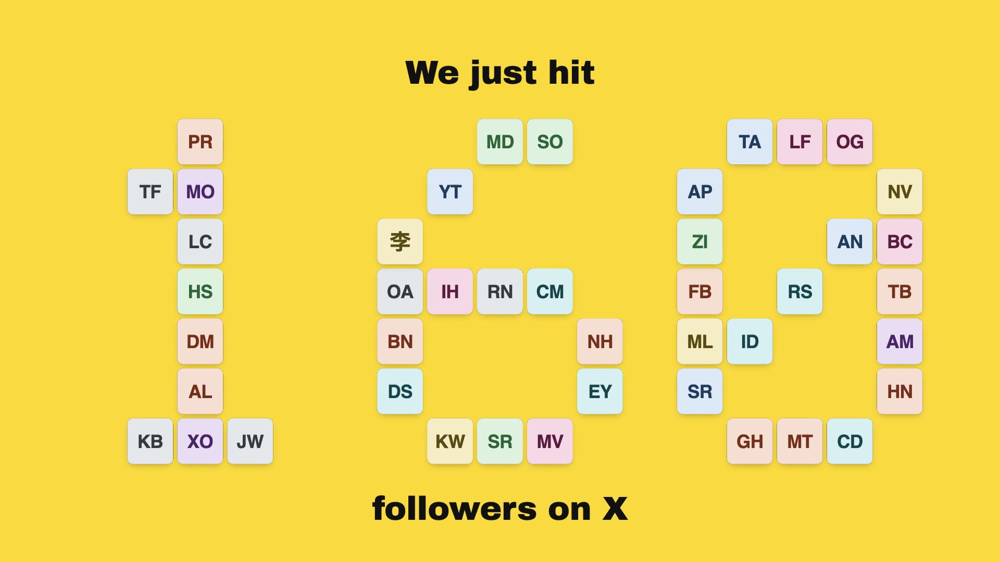
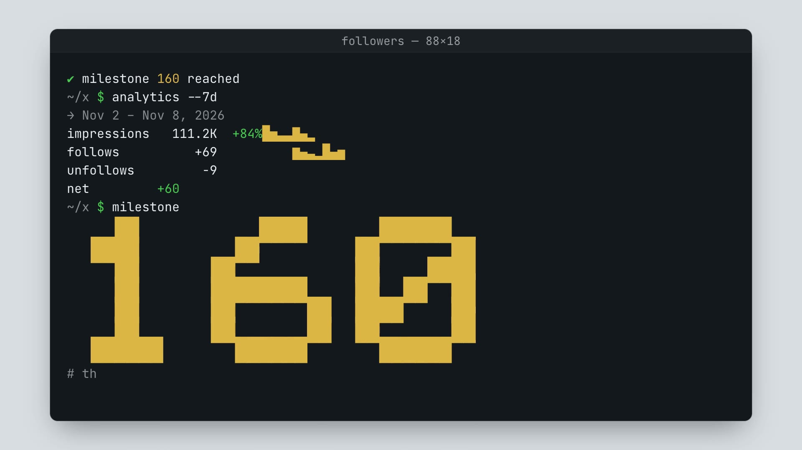

# x-milestone-video

An agent skill that turns an X (Twitter) follower milestone into a short, silent, polished video.
Four templates, each in 16:9 and 9:16, rendered by [HyperFrames](https://hyperframes.heygen.com)
from one `data.json`. No paid X API: the data comes from your own browser, a CSV, or just the number.

| wall | mosaic | receipt | terminal |
| --- | --- | --- | --- |
|  |  |  |  |


The stills and the GIF are rendered from `examples/data.json`, which is invented (initials instead of
photos). With real follower photos the wall and the mosaic look considerably better.

## Install

```bash
git clone https://github.com/serhiyhvala/x-milestone-video ~/.claude/skills/x-milestone-video
```

Or into a project's `.claude/skills/`. Any agent that reads `SKILL.md` files works (Claude Code,
Codex, Cursor and others). Nothing to `npm install`: the scripts are plain Node 22+, and the renderer runs
as `npx hyperframes@0.9.23`. Chrome is downloaded by HyperFrames on first use; FFmpeg must be installed
(`brew install ffmpeg`, `apt install ffmpeg`, `choco install ffmpeg`).

## Use

Ask your agent for a follower-milestone video. By hand:

```bash
node scripts/doctor.mjs                      # what is missing, and the fallback for each gap
# get data.json: see "Your data" below
node scripts/fetch-avatars.mjs data.json     # downloads photo URLs into pfp/
node scripts/build.mjs --data data.json --template wall --aspect 16x9 --out out/wall-16x9
cd out/wall-16x9 && npm run check && npm run render     # renders/wall-16x9.mp4
```

`--template all --aspect all` builds every variant. `node scripts/build.mjs --list` lists templates.

## Your data

`data.json` holds the milestone, you, the newest followers and the last 7 days. Only `milestone` is
required; everything else degrades gracefully (no analytics: no stats scene; no photos: initials; no
followers: counter and thank-you only). Format: [reference/data.md](reference/data.md).

Ways to fill it, easiest first:

1. **An agent with a browser** injects `scripts/collect-x.js` on your profile, followers and analytics
   pages while you are logged in.
2. **Paste a console snippet.** Open each of the three pages, paste `scripts/collect-x.js` into DevTools,
   the last run copies `data.json` to the clipboard. Read the file before you paste it: pasting code into
   DevTools runs it with your logged-in session, and you should never do that with code you have not read.
   This one touches nothing but the page's DOM and your clipboard. Walkthrough:
   [reference/collecting.md](reference/collecting.md).
3. **X Analytics CSV** for the daily numbers, typed into `analytics`.
4. **By hand**: the number, optionally your name and handle, photos in a `pfp/` folder.

## When you cannot render locally

- **No Chrome or FFmpeg**: open `out/<build>/player/index.html` in any browser (it needs internet for
  GSAP), press Space, and screen-record it. `?rec` hides the controls, `?t=8.5` opens at a time.
- **Docker**: `npm run render:docker` inside the build.
- **GitHub Actions**: fork this repo **privately**, add your `data.json` (and `pfp/`), then
  Actions → *Render milestone video* → Run workflow. The MP4 is attached as an artifact. The workflow
  renders the sample data when no `data.json` exists.

## Verify

```bash
node scripts/test/collect-test.mjs     # the collector against a fixture of x.com's DOM
node scripts/test/verify-all.mjs       # every template × aspect: build, check, render, ffprobe
node scripts/test/verify-all.mjs examples/data-minimal.json --no-render
```

## Privacy

Real follower data never belongs in a public repo. `.gitignore` excludes `data.json` (except under
`examples/`), `pfp/`, `out/` and `renders/`. The sample people are invented.

## License

MIT (see `LICENSE`). The templates are HTML, CSS and GSAP; the renderer, HyperFrames, is a separate
Apache-2.0 tool fetched through `npx` and not redistributed here. GSAP 3 is free for this use under
its standard license.
